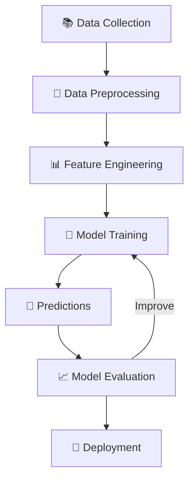

# 🤖 Introduction to Machine Learning

<p align="center">
  
  
  
</p>

<p align="center">
  <b>Learn how machines learn from data, recognize patterns, and make intelligent predictions.</b>
</p>

---

## 📚 Table of Contents

- [📖 Introduction](#-introduction)
- [🧠 AI vs ML vs DL](#-ai-vs-ml-vs-dl)
- [📊 Learning from Historical Data](#-learning-from-historical-data)
- [⚙️ How Machine Learning Works](#️-how-machine-learning-works)
- [📈 Performance vs Data Size](#-performance-vs-data-size)
- [🚀 Why Machine Learning?](#-why-machine-learning)
- [🌍 Real-World Applications](#-real-world-applications)
- [⚖️ Machine Learning vs Deep Learning](#️-machine-learning-vs-deep-learning)
- [🎯 Key Takeaways](#-key-takeaways)
- [📖 Learning Resources](#-learning-resources)

---

## 📖 Introduction

**Machine Learning (ML)** is a subset of Artificial Intelligence (AI) that enables computers to learn from historical data, identify patterns, and make predictions without being explicitly programmed for every task.

AI focuses on creating systems capable of performing tasks that typically require human intelligence, while ML uses algorithms that learn from data to solve problems.

### ✨ Key Benefits

- 📊 Analyze large amounts of data.
- 🔍 Discover hidden patterns.
- 🎯 Make predictions.
- ⚡ Automate repetitive tasks.
- 📈 Improve decision-making.
- 🧩 Solve complex problems.

> 💡 **In simple words:** Machine Learning enables computers to learn from examples and use that knowledge to make predictions about new data.

---

## 🧠 AI vs ML vs DL

Artificial Intelligence, Machine Learning, and Deep Learning are related concepts with different scopes.

```text
Artificial Intelligence (AI)
          |
          └── Machine Learning (ML)
                    |
                    └── Deep Learning (DL)
```

| Technology | Description | Example |
|---|---|---|
| 🧠 AI | Machines performing intelligent tasks | Expert systems |
| 🤖 ML | Machines learning from data | Price prediction |
| 🧬 DL | Neural networks learning complex patterns | Image recognition |

### 🔑 Key Differences

- **AI:** The broader field of intelligent systems.
- **ML:** A subset of AI that learns from data.
- **DL:** A subset of ML that uses deep neural networks.

---

## 📊 Learning from Historical Data

Historical data is one of the most important components of Machine Learning.

ML algorithms analyze data to discover patterns, relationships, and trends. These patterns help models make predictions about previously unseen data.

### 🏠 Example: House Price Prediction

Suppose we have historical house price data.

| Size (sq. ft.) | Bedrooms | Price |
|---:|---:|---:|
| 1,000 | 2 | ₹30 Lakhs |
| 1,500 | 3 | ₹45 Lakhs |
| 2,000 | 3 | ₹65 Lakhs |
| 2,500 | 4 | ₹85 Lakhs |

A Machine Learning model learns relationships between house features and prices.

After training, it can estimate the price of a new house.

> ⚠️ More data does not always mean better performance. Data quality, relevance, and model selection also matter.

---

## ⚙️ How Machine Learning Works

A typical Machine Learning workflow includes the following steps:



### 🔄 Workflow Explained

1. **Data Collection:** Gather relevant information.
2. **Data Preprocessing:** Clean and prepare the dataset.
3. **Feature Engineering:** Select or transform useful input features.
4. **Model Training:** Allow an algorithm to learn patterns.
5. **Prediction:** Generate outputs for new data.
6. **Evaluation:** Measure model performance.
7. **Deployment:** Use the model in a real-world application.

---

## 📈 Performance vs Data Size

Increasing the amount of training data can improve model performance, but the improvement depends on the algorithm and problem.

Traditional Machine Learning often works well with structured data, while Deep Learning can be particularly effective for complex data such as images, audio, and text.

```text
Performance
    ^
    |
    |                       ________
    |                  ____/
    |             ____/
    |        ____/
    |   ____/
    |__/
    +--------------------------------> Data Size
```

*Illustrative diagram: actual performance depends on the dataset, model, and task.*

### 🧬 Understanding Deep Learning

Deep Learning uses artificial neural networks containing multiple layers.

These networks learn complex representations from data and are useful for:

- 🖼️ Image recognition.
- 🎙️ Speech processing.
- 💬 Natural Language Processing.
- 🚗 Autonomous driving.
- 🧪 Scientific research.

Deep Learning is not always better than traditional Machine Learning. The right approach depends on the problem and available resources.

---

## 🚀 Why Machine Learning?

### 1. 📊 Data-Driven Insights

ML identifies patterns and trends that help organizations make informed decisions.

**Example:** Predicting customer preferences from purchase history.

### 2. ⚡ Automation and Efficiency

ML automates repetitive tasks and reduces manual effort.

**Example:** Automatically filtering spam emails.

### 3. 📦 Data Processing

ML processes large datasets to identify useful relationships.

**Example:** Detecting suspicious financial transactions.

### 4. 🔮 Predictive Analysis

ML models use historical information to estimate future outcomes.

**Example:** Forecasting product demand.

### 5. 🌍 Industry Transformation

ML improves productivity, personalization, and decision-making across industries.

**Example:** Predicting equipment failures before breakdowns occur.

---

## 🌍 Real-World Applications

Machine Learning is widely used across different industries.

| Industry | Application |
|---|---|
| 🏥 Healthcare | Disease prediction |
| 🏦 Banking | Fraud detection |
| 🛒 E-commerce | Product recommendations |
| 🚗 Transportation | Traffic prediction |
| 🎓 Education | Personalized learning |
| 🏭 Manufacturing | Predictive maintenance |
| 📧 Communication | Spam detection |
| 🎬 Entertainment | Content recommendations |

### 💡 Everyday Examples

- **Search Engines:** Retrieve relevant information.
- **Streaming Platforms:** Recommend movies and videos.
- **Email Services:** Identify spam messages.
- **Navigation Apps:** Estimate travel times.
- **Shopping Platforms:** Recommend products.
- **Voice Assistants:** Recognize speech and interpret requests.

---

## ⚖️ Machine Learning vs Deep Learning

| Feature | Machine Learning | Deep Learning |
|---|---|---|
| Algorithms | Decision Trees, SVM, Random Forest | CNNs, RNNs, Transformers |
| Data Requirements | Often effective with smaller datasets | Often benefits from large datasets |
| Feature Engineering | Frequently requires manual feature engineering | Can learn features automatically |
| Training Cost | Often lower for simpler models | Can require substantial computing power |
| Interpretability | Some models are easier to explain | Complex models can be difficult to interpret |
| Applications | Tabular data, forecasting | Images, audio, and language |

### 🎯 Which Should You Choose?

**Choose traditional ML when:**

- Working with structured datasets.
- Computational resources are limited.
- Interpretability is important.
- Simpler models meet your requirements.

**Consider Deep Learning when:**

- Working with complex images, audio, or text.
- Sufficient data or pretrained models are available.
- More computational resources are accessible.
- Neural networks suit the task.

---

## 🎯 Key Takeaways

- ✅ Machine Learning is a subset of Artificial Intelligence.
- ✅ ML algorithms learn patterns from data.
- ✅ Historical data helps models make predictions.
- ✅ Data quality is essential for reliable results.
- ✅ Deep Learning uses multi-layered neural networks.
- ✅ ML supports automation and data-driven decisions.
- ✅ Different algorithms suit different problems.
- ✅ Model evaluation helps measure performance.
- ✅ ML is transforming industries worldwide.

---

## 📖 Learning Resources

Explore these resources to continue learning.

| Resource | Purpose |
|---|---|
| [Google ML Crash Course](https://developers.google.com/machine-learning/crash-course) | Learn ML fundamentals |
| [Scikit-learn](https://scikit-learn.org/stable/) | Explore traditional ML algorithms |
| [TensorFlow](https://www.tensorflow.org/tutorials) | Learn Deep Learning |
| [PyTorch](https://pytorch.org/tutorials/) | Build neural networks |
| [Kaggle](https://www.kaggle.com/) | Practice with datasets |

---

## 🛣️ What's Next?

Follow this learning path to strengthen your fundamentals.

1. 🐍 Python Programming
2. 📐 Mathematics and Statistics
3. 🧹 Data Preprocessing
4. 📊 Exploratory Data Analysis
5. 📚 Supervised Learning
6. 🔍 Unsupervised Learning
7. ⚙️ ML Algorithms
8. 📏 Model Evaluation
9. 🧠 Neural Networks
10. 🚀 Real-World Projects

---

<p align="center">
  <b>🚀 Learn from data. Discover patterns. Build intelligent solutions.</b>
  <br><br>
  ⭐ If you find this repository helpful, consider giving it a star!
</p>