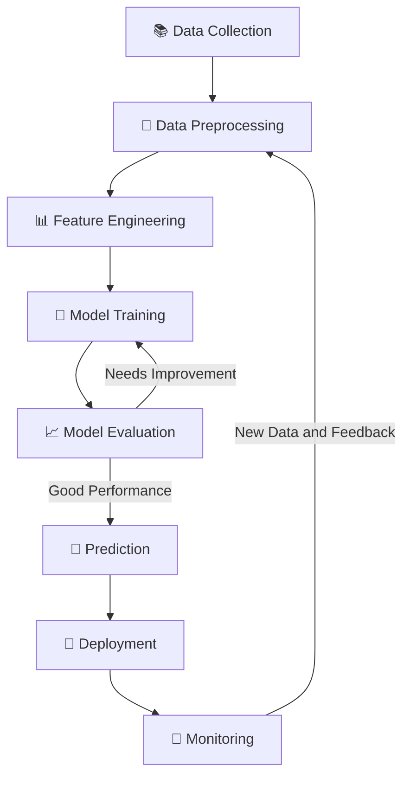

# 🤖 Introduction to Machine Learning

<p align="center">
  
  
  
</p>

<p align="center">
  <b>Learn how machines learn from data, recognize patterns, and make intelligent predictions.</b>
</p>

---

## 📚 Table of Contents

- [📖 Introduction](#-introduction)
- [📜 History and Evolution of Machine Learning](#-history-and-evolution-of-machine-learning)
- [🧠 AI vs ML vs DL](#-ai-vs-ml-vs-dl)
- [📊 Learning from Historical Data](#-learning-from-historical-data)
- [⚙️ How Machine Learning Works](#️-how-machine-learning-works)
- [🧩 Types of Machine Learning](#-types-of-machine-learning)
- [📈 Performance vs Data Size](#-performance-vs-data-size)
- [🚀 Why Machine Learning?](#-why-machine-learning)
- [🌍 Real-World Applications](#-real-world-applications)
- [⚖️ Machine Learning vs Deep Learning](#️-machine-learning-vs-deep-learning)
- [🎯 Key Takeaways](#-key-takeaways)
- [📖 Learning Resources](#-learning-resources)

---

## 📖 Introduction

**Machine Learning (ML)** is a subset of Artificial Intelligence (AI) that enables computers to learn patterns from data and make predictions or decisions without being explicitly programmed for every situation.

Instead of relying entirely on predefined rules, ML algorithms use examples and experience to improve their performance on specific tasks.

Artificial Intelligence focuses on creating systems capable of performing tasks that typically require human intelligence, while Machine Learning provides techniques that allow these systems to learn from data.

### ✨ Key Benefits

- 📊 Analyze large amounts of data.
- 🔍 Discover hidden patterns and relationships.
- 🎯 Make predictions using historical information.
- ⚡ Automate repetitive tasks.
- 📈 Support data-driven decision-making.
- 🧩 Solve complex problems.

> 💡 **In simple words:** Machine Learning enables computers to learn from examples and use that knowledge to make predictions about new data.

---

## 📜 Evolution of Machine Learning

Machine Learning has evolved from early theoretical concepts into powerful algorithms capable of learning from data, recognizing patterns, and making predictions.

Its development reflects decades of research in mathematics, statistics, artificial intelligence, and computing.

Understanding this evolution helps explain how modern intelligent systems have transformed technology and everyday life.

### 🔄 Evolution of Machine Learning

| Period | Development | Key Characteristics |
|---|---|---|
| 1940s–1950s | Theoretical foundations | Mathematical models of neurons and early AI concepts |
| 1950s–1960s | Early learning algorithms | Perceptrons, pattern recognition, and learning programs |
| 1970s–1980s | Symbolic learning and neural networks | Decision trees, expert systems, and backpropagation |
| 1990s | Statistical Machine Learning | SVMs, Bayesian networks, and ensemble methods |
| 2000s | Data-driven ML | Larger datasets and improved computing resources |
| 2010s | Deep Learning | Multilayer neural networks and GPU acceleration |
| 2017 onward | Transformer models | Advanced language processing and representation learning |
| 2020s | Generative AI | Text, image, audio, and code generation |

### 📈 From Traditional ML to Generative AI

```text
Early Artificial Intelligence
             |
             v
 Classical Machine Learning
             |
             v
      Deep Learning
             |
             v
 Transformer Architecture
             |
             v
        Generative AI
```

*Note: This is a simplified illustration of major developments. These approaches overlap and continue to evolve alongside one another.*

### 🌍 Modern Trends in Machine Learning

- 🧠 **Generative AI:** Creating text, images, audio, and code.
- ⚖️ **Responsible AI:** Improving fairness, privacy, transparency, and accountability.
- 🔍 **Explainable AI:** Making model predictions easier to understand.
- 🤝 **Reinforcement Learning:** Learning through actions, feedback, and rewards.
- ⚛️ **Quantum Machine Learning:** Exploring the intersection of quantum computing and learning algorithms.

> 🎯 **Key Insight:** Machine Learning has evolved from early mathematical ideas and experimental learning programs into a broad field powering many modern AI applications. Better algorithms, more data, and greater computing power have driven much of this progress.

---

## 🧠 AI vs ML vs DL

Artificial Intelligence, Machine Learning, and Deep Learning are related concepts with different scopes.

```text
Artificial Intelligence (AI)
          |
          └── Machine Learning (ML)
                    |
                    └── Deep Learning (DL)
```

| Technology | Description | Example |
|---|---|---|
| 🧠 Artificial Intelligence (AI) | The broader field of building intelligent systems | Rule-based expert systems |
| 🤖 Machine Learning (ML) | Algorithms that learn patterns from data | House price prediction |
| 🧬 Deep Learning (DL) | Machine Learning using multilayer neural networks | Image recognition |

### 🔑 Key Differences

- **AI:** The broader field of intelligent systems.
- **ML:** A subset of AI that learns from data.
- **DL:** A subset of ML that uses deep neural networks to learn complex representations.

---

## 📊 Learning from Historical Data

Historical data is one of the most important components of Machine Learning.

ML algorithms analyze data to discover patterns, relationships, and trends. These patterns help models make predictions about previously unseen data.

### 🏠 Example: House Price Prediction

Suppose we have historical house price data.

| Size (sq. ft.) | Bedrooms | Price |
|---:|---:|---:|
| 1,000 | 2 | ₹30 Lakhs |
| 1,500 | 3 | ₹45 Lakhs |
| 2,000 | 3 | ₹65 Lakhs |
| 2,500 | 4 | ₹85 Lakhs |

A Machine Learning model analyzes the relationship between house features and prices.

After training, the model can estimate the price of a new house based on its features.

For example, the model might estimate the price of a 1,800-square-foot house with three bedrooms.

The actual prediction would depend on the training data, location, property condition, and other relevant factors.

### 🔑 Important Concepts

- **Dataset:** A collection of examples used for analysis and learning.
- **Features:** Input variables used to make predictions, such as house size and number of bedrooms.
- **Target:** The value a model attempts to predict, such as house price.
- **Training:** The process through which an algorithm learns patterns from data.
- **Prediction:** The output generated for new input data.

> ⚠️ More data does not always mean better performance. Data quality, relevance, representativeness, and model selection also matter.

---

## ⚙️ How Machine Learning Works

A typical Machine Learning workflow includes several steps, from collecting data to deploying and monitoring a trained model.

### 🔄 Machine Learning Workflow



### 📝 Workflow Explained

1. **Data Collection:** Gather relevant information from databases, files, sensors, or other sources.
2. **Data Preprocessing:** Clean the dataset, handle missing values, and correct inconsistencies.
3. **Feature Engineering:** Select, create, or transform useful input variables.
4. **Model Training:** Use an algorithm to learn patterns from the training data.
5. **Model Evaluation:** Measure performance using appropriate metrics and validation data.
6. **Prediction:** Generate outputs for previously unseen examples.
7. **Deployment:** Integrate the trained model into an application or production system.
8. **Monitoring:** Track performance and identify when retraining or improvement is needed.

> 💡 **Important:** Training and evaluation should use appropriately separated datasets to estimate how well the model generalizes to unseen data.

---

## 📈 Performance vs Data Size

Increasing the amount of training data can improve model performance, but the results depend on the algorithm, dataset, and task.

Traditional Machine Learning often performs well on structured data, while Deep Learning can be particularly effective for complex data such as images, audio, and text.

### 📊 Illustrative Relationship

```text
Performance
    ^
    |
    |                       ________
    |                  ____/
    |             ____/
    |        ____/
    |   ____/
    |__/
    +--------------------------------> Training Data Size
```

*Illustrative diagram only. Actual performance may improve, plateau, or decline depending on data quality, model choice, overfitting, and other factors.*

### 🧬 Understanding Deep Learning

Deep Learning uses artificial neural networks containing multiple layers.

These networks learn increasingly complex representations from data and are useful for:

- 🖼️ Image recognition.
- 🎙️ Speech processing.
- 💬 Natural Language Processing.
- 🚗 Autonomous driving research.
- 🧪 Scientific research.
- 🎨 Generative content creation.

Deep Learning is not always better than traditional Machine Learning. The appropriate approach depends on the problem, dataset, interpretability requirements, and available resources.

---

## 🚀 Why Machine Learning?

### 1. 📊 Data-Driven Insights

ML identifies patterns and trends that help organizations make informed decisions.

**Example:** Predicting customer preferences from purchase history.

### 2. ⚡ Automation and Efficiency

ML can automate repetitive tasks and reduce manual effort.

**Example:** Automatically identifying spam emails.

### 3. 📦 Large-Scale Data Analysis

ML helps analyze large datasets to identify useful relationships that may be difficult to detect manually.

**Example:** Detecting suspicious financial transactions.

### 4. 🔮 Predictive Analysis

ML models use historical information to estimate future outcomes.

**Example:** Forecasting product demand.

### 5. 🎯 Personalization

ML can adapt recommendations and services to individual preferences.

**Example:** Recommending movies based on viewing history.

### 6. 🌍 Industry Transformation

ML improves productivity and supports decision-making across many industries.

**Example:** Predicting equipment failures before they occur.

---

## 🌍 Real-World Applications

Machine Learning is widely used across different industries.

| Industry | Application |
|---|---|
| 🏥 Healthcare | Medical image analysis and risk prediction |
| 🏦 Banking | Fraud detection and credit risk assessment |
| 🛒 E-commerce | Product recommendations and demand forecasting |
| 🚗 Transportation | Traffic prediction and route optimization |
| 🎓 Education | Personalized learning systems |
| 🏭 Manufacturing | Predictive maintenance and quality inspection |
| 📧 Communication | Spam filtering and message classification |
| 🎬 Entertainment | Movie, music, and video recommendations |
| 🌾 Agriculture | Crop monitoring and yield prediction |
| 🔐 Cybersecurity | Threat and anomaly detection |

### 💡 Everyday Examples

- **Search Engines:** Rank and retrieve relevant information.
- **Streaming Platforms:** Recommend movies, shows, and music.
- **Email Services:** Identify spam and suspicious messages.
- **Navigation Apps:** Estimate travel times and suggest routes.
- **Shopping Platforms:** Recommend relevant products.
- **Voice Assistants:** Recognize speech and interpret requests.
- **Translation Tools:** Translate text between languages.
- **Smart Devices:** Recognize patterns and automate certain tasks.

---

## ⚖️ Machine Learning vs Deep Learning

Deep Learning is a specialized branch of Machine Learning that uses neural networks with multiple layers.

Although both approaches learn from data, they can differ in their data requirements, computational costs, and suitability for specific tasks.

| Feature | Traditional Machine Learning | Deep Learning |
|---|---|---|
| Algorithms | Decision Trees, SVM, Random Forest | CNNs, RNNs, Transformers |
| Data Requirements | Often effective with smaller datasets | Often benefits from large datasets |
| Feature Engineering | Frequently requires manual feature engineering | Can learn useful features automatically |
| Training Cost | Often lower for simpler models | Can require substantial computing power |
| Interpretability | Some models are relatively easy to explain | Complex models can be difficult to interpret |
| Structured Data | Often highly effective | Can be effective, but is not always the best choice |
| Complex Data | Requires suitable feature representations | Particularly effective for images, audio, and language |
| Hardware | Can often run on standard CPUs | Large models may require GPUs or specialized hardware |

### 🎯 Which Should You Choose?

**Choose Traditional Machine Learning when:**

- Working with structured or tabular datasets.
- Computational resources are limited.
- Interpretability is important.
- A simpler model meets the performance requirements.

**Consider Deep Learning when:**

- Working with complex images, audio, or text.
- Large datasets or suitable pretrained models are available.
- Sufficient computational resources are accessible.
- Neural networks are appropriate for the task.

> 💡 **Remember:** The best model is not necessarily the most complex one. Choose the approach that performs reliably and meets the project's requirements.

---

## 🎯 Key Takeaways

- ✅ Machine Learning is a subset of Artificial Intelligence.
- ✅ ML algorithms learn patterns from data.
- ✅ Historical data can help models make predictions.
- ✅ Data quality is essential for reliable results.
- ✅ Machine Learning includes supervised, unsupervised, and reinforcement learning.
- ✅ Deep Learning uses multilayer neural networks.
- ✅ Different algorithms suit different problems.
- ✅ Model evaluation helps measure performance on unseen data.
- ✅ Machine Learning supports automation and data-driven decisions.
- ✅ Responsible AI practices help address fairness, privacy, and transparency.
- ✅ Machine Learning continues to evolve alongside computing and AI research.

---

<p align="center">
  <b>🚀 Learn from data. Discover patterns. Build intelligent solutions.</b>
  <br><br>
  ⭐ If you find this repository helpful, consider giving it a star!
</p>